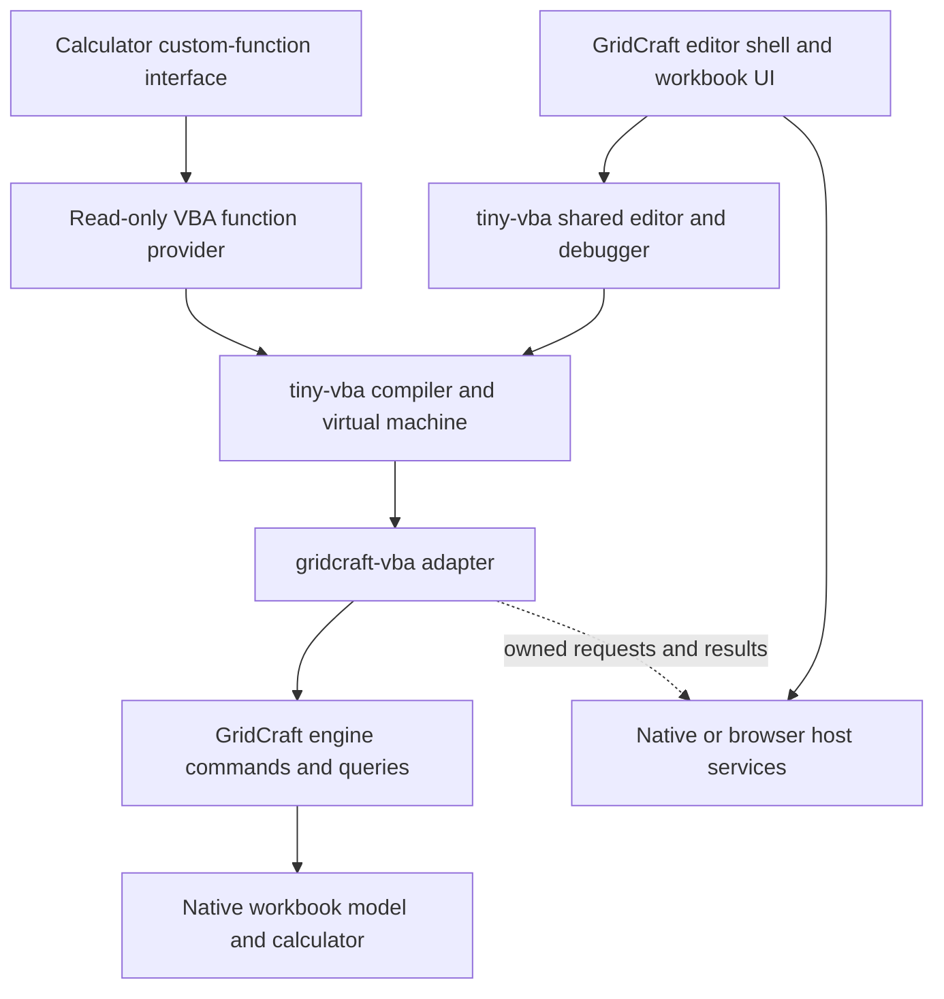

# How VBA integration works

GridCraft embeds tiny-vba and supplies an Excel-shaped view of its native
workbook model. The interpreter executes VBA; GridCraft owns workbook objects,
commands, calculation, persistence and UI services. The entry guide is
[VBA in GridCraft](../vba.md); the feature contract is split into
[supported](supported.md) and [unsupported](unsupported.md) references.

## Components and dependencies



| Component | Responsibility |
|---|---|
| tiny-vba | VBA syntax, compilation, verified IR, values/coercion, VM, debugger, source importer, shared editor and generic host protocol |
| [`gridcraft-vba`](../../crates/vba/src/lib.rs) | Excel/Office nominal types, member dispatch, object identities, value conversion, event delivery and owned host continuations |
| [`gridcraft-engine`](../../crates/engine/src/lib.rs) | Native commands, permission checks, undo, recalculation, documents/windows and file operations |
| [`ui-egui` VBA shell](../../crates/ui-egui/src/vba.rs) | Editor presentation, user consent, source IO, native/browser services and bounded logic ticks |
| [Worksheet provider](../../crates/vba/src/worksheet.rs) | Read-only custom-function execution through the calculator's generic provider interface |

`gridcraft-vba` is a toolkit-free adapter above the engine. No VBA dependency
enters the model, calculator or engine. Private family modules handle formulas,
formatting, data, tables, charts, pivots, windows, protection, printing,
annotations and interaction, sharing the same handle store and descriptors.

The compiler/runtime/editor remain in the separate
[tiny-vba repository](https://github.com/matt123p/tiny-vba). Cargo manifests and
Cargo.lock pin an immutable Git revision. There is no local-path dependency or
copied interpreter. The manifests are the authority for the active pin; changes
to the shared language runtime belong in that dependency.

## Native commands and undo

VBA property assignments and methods call native engine commands or typed APIs
that share their execution path. For example, a Range value write uses
`Session::set_range_contents`, the typed API for `range.setContents`.
The engine owns protection, validation, recalculation, recording and history.
[Native cell contents](../native-cell-contents.md) documents that generic API.

Typed VBA values cross a native host protocol rather than JSON member dispatch.
JSON envelopes are produced where the engine needs replayable journal/recording
entries. This keeps replay and UI/control calls on the same mutation path.

A macro/event batch holds a spanning undo group through pause, step and resume.
Completion, failure or Reset finishes successful writes as a grouped undo entry.
A later failure does not automatically roll back earlier successful operations.
Supported bounded writes validate their own input and permissions before effects.

The bridge restores the visible document/window after scoped calls on an
inactive captured owner. Application-wide operations preflight participating
documents and their consent before making changes.

## Objects, context and values

The adapter supplies nominal declarations through the same ReferenceSet used by
execution. A type declaration alone does not implement all members of that Excel
class. The descriptors and family dispatch handlers define the available subset.

Object references are bounded handles into one shared store. They carry host,
document and generation identity; sheet and native child identities prevent a
deleted object from aliasing a replacement with the same name or numeric ID.
Objects retained through rename/reorder continue to refer to their captured
owner. Unsupported topology/undo changes can invalidate coordinates or snapshot
handles rather than silently retarget them.

`ThisWorkbook` means the code owner's workbook. `ActiveWorkbook`, `ActiveSheet`,
`ActiveCell` and Selection resolve live application state on each access.
Capturing an object retains that owner even when the user activates another
workbook. Worksheet document modules bind implicit `Me`/bare worksheet members
to their own sheet. Completion uses read-only metadata and never calls a member
or edits a workbook.

VBA values retain their types inside the VM. Worksheet storage uses GridCraft
numbers, strings, Boolean values and cell errors. Value/Value2 conversion handles
Date/Currency distinctions and workbook date systems. Arrays cross the boundary
between row-major worksheet/calculator storage and VBA's column-major arrays.
Bounds, shape, exact numeric representation and payload size are checked.

## Trust and execution lifecycle

Source import and project opening are inert. File provenance, document trust and
explicit editor-session consent are checked before execution, on logic ticks and
on late-bound host calls. Script trust is not a grant of VBA permission.
Consent for one workbook does not authorize a workbook opened from its macro.

Reset, closing the owning document, revoking consent or invalidating source
cancels queued work and outstanding requests. No mutable document borrow or
object-store lock is retained across a VM tick, callback, UI frame or wait.
Supported errors are returned as VBA errors/diagnostics and remain catchable
where the language handler permits it.

## Events and cancellation

The connected event profile covers explicit trusted Workbook_Open,
Worksheet_Change, workbook BeforeSave/BeforeClose/AfterSave, and corresponding
Application save/close callbacks. Enabling VBA does not enable automatic
execution on file open.

Events enter a bounded FIFO and run after the current invocation/callback reaches
a delivery boundary. Callback writes append later events rather than reentering
the interpreter. `EnableEvents = False` suppresses new notifications and clears
the queued remainder; reenabling it affects future notifications. Failure,
Reset, trust revocation and owner close cancel the remaining queue.

For supported VBA value-changing operations, the bridge prepares the whole event
batch before mutation: callback owner and Target handles, arguments and queue
capacity. Commit enqueues the prepared batch without fallible allocation.
Native UI/control edits have a different boundary: if their edit has already
committed and event capacity is exhausted, the edit stays committed and the host
reports the delivery failure.

BeforeSave/BeforeClose callbacks run before their native operation, with ByRef
Cancel carried through document and connected Application handlers in order.
AfterSave reports actual I/O success/failure. Callback lookup stays bound to the
project/document identity, including while another workbook is active.

## Prompts, files, print and other host services

A macro can suspend for a configured native picker, save decision, dialog,
printer, preview or browser callback. A parked request owns only bounded tokens,
payloads and identity/context snapshots. On completion, the bridge checks the
request token, source, owner and consent before resuming. Cancellation/errors
propagate explicitly; rendering another frame cannot replay an effect.

The same mechanism handles current-project `Application.Run`: child procedures
share project state, debugger and cumulative budgets. Cross-project execution
needs a separate project host and is not provided.

Headless hosts either supply a concrete service or use supported explicit
arguments. Browser hosts supply their own download/print/UI callbacks. Generating
PDF bytes does not count as successfully printing, downloading or opening preview.

## Worksheet UDFs

Applying public Functions installs a provider on the owning open document through
`calc::CustomFunctions`. The calculator does not know about VBA types or the UI.
The adapter compiles bounded wrappers that retain VBA coercion/default handling
and creates a constrained execution context for calculation.

Scalar/Variant parameters receive values or bounded arrays. Supported Range/Object
parameters retain read-only reference provenance, including Caller and bounded
range queries. The UDF host cannot mutate the engine, prompt or await asynchronous
operations. Results use normal calculator scalar/error/spill behavior. Source,
consent and object lifetime are checked again before execution; stale compiled
source is not silently substituted after undo or replacement.

## Source and workbook persistence

Standard-module source and toolbar assignments use GridCraft's existing chunked
hidden-name storage via `workbook.setItem`. Worksheet macro assignments belong to
native shapes (`on_action`/`shape.setMacro`) and persist with DrawingML metadata.
This keeps assignment identity with the shape through rename, deletion, undo and
package ID remapping.

An imported Excel `vbaProject.bin` is retained as opaque package data. Editing
plain source does not rewrite that binary. Class/form projects and binary form
resources have separate storage limitations; export unsupported project content
as plain source instead of assuming it is saved into Excel's project.

## Editor presentation

`vba` embeds the shared editor. `vba-window` adds one native viewport for the same
Ide/Bridge/project. The parent logic loop alone advances execution; rendering the
child viewport cannot run a second VM slice. Closing the editor's OS window hides
it while retaining source/debug state. Explicit project/document close still
checks dirty source and cancels outstanding work. Browsers always embed.

`vba.open {"separateWindow": false}` requests embedded presentation. A true value
requires the native window feature and host. Reopening retains an existing
project's presentation unless explicitly changed.

## Control commands

These UI commands use `SheetApp::run` and the desktop `engine.execute` control
route. Programmatic calls return errors instead of opening implicit dialogs.

| Command | Parameters and behavior |
|---|---|
| `vba.open` | `{source?, project?, separateWindow?, entry?}`; open/focus/import/navigate without execution |
| `vba.importSource` | Import plain source/form files using the configured native picker; editor must be open. Browser/automation hosts can provide source through `vba.open` |
| `vba.compile` | Compile the current project |
| `vba.run` | `{entry?}`; run/continue using subsequent bounded logic ticks |
| `vba.stepInto`, `vba.stepOver`, `vba.stepOut` | Debugger stepping |
| `vba.pause`, `vba.reset` | Pause/stop; retain successful earlier workbook edits |
| `vba.status` | Mode, presentation, output, diagnostics and lifecycle status |
| `vba.showDeveloper` | `{on}`; persisted Developer-tab visibility |
| `vba.apply` | Save supported standard-module source to workbook storage and register public Functions |
| `vba.entries` | Discover public Subs and Functions, including signatures |
| `vba.invoke` | `{entry}`; explicitly run a public no-argument Sub |
| `vba.assign` | `{entry, id?, at?, caption?}`; assign a shape or insert a native button |
| `vba.pin` | `{entry, remove?}`; add/remove a workbook macro on the Quick Access Toolbar |
| `vba.designMode` | `{on}`; edit assigned shapes instead of executing them |
| `vba.trust` | `{allow}`; grant/revoke consent for this editor/document instance |
| `vba.return` | Return to the workbook while retaining project/debug state |
| `vba.close` | `{discard?}`; close, refusing unapproved dirty-source loss |

## Keeping reference data current

The [reference directory](reference/README.md) holds source provenance and
machine-checked evidence. The optional offline exporter validates source-page
identity, types, reachable receivers, enum dependencies, collection contracts and
linked implementation tests. It also refreshes the function/member indexes in
the supported reference. It does not fetch documentation during ordinary builds.

```sh
cargo run -p xtask --features vba-audit -- vba-audit --write
cargo run -p xtask --features vba-audit -- vba-audit
```

The exporter expects the pinned public documentation archive at
`target/vba-docs-audit/reference.zip` and verifies its checksum before use. Ordinary
builds and tests do not require that archive. Runtime/feature tests live in
[`crates/vba/tests`](../../crates/vba/tests); UI tests are in
[`crates/ui-egui/tests`](../../crates/ui-egui/tests). Run appropriate native/WASM
and host/UI checks when changing those behaviors. Catalogue counts and static
graph checks are not measurements of unchanged Excel-workbook compatibility.
