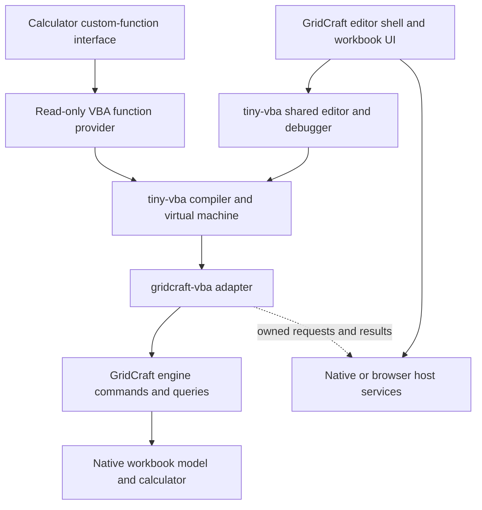
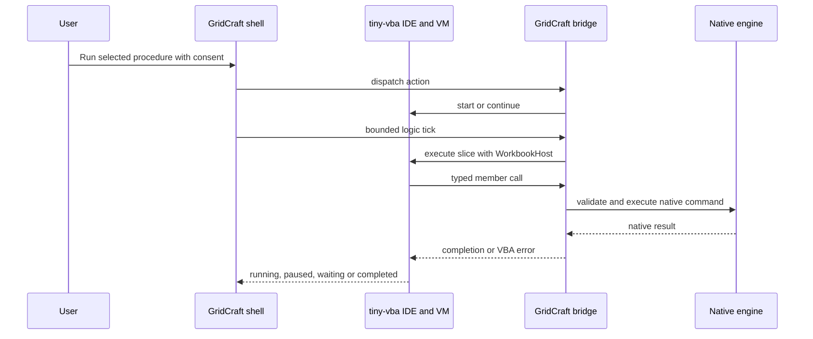

# How VBA integration works

GridCraft embeds tiny-vba and supplies an Excel-shaped view of its native
workbook model. The interpreter executes VBA; GridCraft owns workbook objects,
commands, calculation, persistence and UI services. The entry guide is
[VBA in GridCraft](../vba.md); the feature contract is split into
[supported](supported.md) and [unsupported](unsupported.md) references.

For a first read, follow [startup and execution](#startup-and-execution), then
[the design decisions](#design-decisions-and-trade-offs). The later sections
explain individual boundaries and link to the code that implements them.

## Components and dependencies



| Component | Responsibility |
|---|---|
| tiny-vba | VBA syntax, compilation, verified IR, values/coercion, VM, debugger, source importer, shared editor and generic host protocol |
| [`gridcraft-vba`](../../crates/vba/src/lib.rs) | Excel/Office nominal types, member dispatch, object identities, value conversion, event delivery and owned host continuations |
| [`gridcraft-engine`](../../crates/engine/src/lib.rs) | Native commands, permission checks, undo, recalculation, documents/windows and file operations |
| [`ui-egui` VBA shell](../../crates/ui-egui/src/vba.rs) | Editor presentation, user consent, source IO, native/browser services and bounded logic ticks |
| [Worksheet provider](../../crates/vba/src/worksheet.rs) | Read-only custom-function execution through the calculator's generic provider interface |

`gridcraft-vba` is a toolkit-free adapter above the engine. No VBA dependency
enters the model, calculator or engine. Private family modules handle formulas,
formatting, data, tables, charts, pivots, windows, protection, printing,
annotations and interaction, sharing the same handle store and descriptors.

The compiler/runtime/editor remain in the separate
[tiny-vba repository](https://github.com/matt123p/tiny-vba). Cargo manifests and
Cargo.lock pin an immutable Git revision. There is no local-path dependency or
copied interpreter. The manifests are the authority for the active pin; changes
to the shared language runtime belong in that dependency.

### How the tiny-vba crates fit together

The dependency boundary is a Rust API within the application. Execution does
not require Office, a COM server, an external interpreter process or source-file
synchronization between the editor and the workbook.

| tiny-vba crate | Role in this integration |
|---|---|
| `vba-syntax`, `vba-compiler`, `vba-ir`, `vba-diagnostics` | Parse/compile source and report diagnostics; verified executable metadata carries generic language/type requirements |
| `vba-values`, `vba-runtime` | Typed VBA values, arrays, coercion, intrinsic functions and explicitly configured runtime services |
| `vba-foreign` | Native object handles, typed host arguments/calls/results/errors and reference/type-resolution contracts |
| `vba-vm` | Execute compiled code within budgets, suspend host calls and resume/cancel them through the host protocol |
| `vba-project` | Decode supported source and module metadata from an imported binary VBA project, subject to decoder limits |
| `vba-ide` | Own project/editor execution state, debugger actions, host configuration and callback scheduling |
| `vba-ui-egui` | Render the shared editor, debugger and form UI inside GridCraft's shell |

The [adapter manifest](../../crates/vba/Cargo.toml) pins the compiler/runtime
crates; the [UI manifest](../../crates/ui-egui/Cargo.toml) pins the shared editor
to the same tiny-vba revision. Keeping them together avoids mismatched value,
IR, host and UI contracts. The workspace [egui patches](../../Cargo.toml) select
a compatible egui family for GridCraft and tiny-vba widgets, so the
shared editor participates in the same UI context, theme and font handling.

The desktop [application features](../../apps/gridcraft/Cargo.toml) forward
`vba` and `vba-window` to the UI crate. The
[browser feature](../../apps/gridcraft-web/Cargo.toml) enables the same adapter
and shared editor while excluding native-window presentation. The adapter is
usable without that UI; its tests drive the real engine through the same bridge.

### Host configuration

[`Bridge::configure_document`](../../crates/vba/src/lib.rs) configures an Ide for
its code-owner workbook. It installs:

- Imported host globals, root handles and supported member metadata for binding
  and completion.
- Excel/Office reference libraries, enums and constants from
  [`types::references`](../../crates/vba/src/types.rs).
- A read-only type resolver over the existing bridge object store; tiny-vba
  validates nominal identity without owning a second workbook-object registry.
- Document-module code-name mappings and implicit-member context. Display names
  alone cannot identify `ThisWorkbook` or a worksheet code module.
- Execution limits and the configured binary string-comparison/runtime context.

These declarations are metadata. Looking up a member for completion or resolving
an `As Worksheet` declaration does not call the engine. Actual access goes through
the host at runtime, where liveness, permissions and the supported operation are
checked again. Excel type names and member semantics remain in GridCraft;
tiny-vba owns the reusable rules for binding, identity and invocation.

## Startup and execution

The [shell's editor state](../../crates/ui-egui/src/vba.rs) retains an `Ide`,
`Bridge` and shared `EditorUi`. Their responsibilities stay separate throughout
an invocation:

1. **Open source.** `vba.open` creates a bridge bound to the workbook. Normally it
   prefers applied GridCraft source, then imported binary-project source, then a
   blank standard module. Explicit source/project arguments select the requested
   input. Importing only decodes/adds source; it never runs it.
2. **Configure and compile.** The bridge supplies the host/type/document metadata.
   tiny-vba parses and compiles the project and reports diagnostics. The shared
   editor can inspect source and completion without workbook side effects.
3. **Start explicitly.** Run/step actions pass through `Bridge::dispatch`, which
   checks the document and consent and opens the appropriate native undo group.
4. **Advance in bounded slices.** Parent shell logic calls `Bridge::tick` (or the
   lifecycle-specific tick while collecting save/close callbacks). tiny-vba owns
   the instruction pointer, stack, variables, breakpoints and runtime state.
5. **Invoke native behavior.** A host member produces a typed `HostCall` containing
   an opaque target, invocation kind, member name and named/positional arguments.
   `WorkbookHost::invoke` validates the handle/owner, scopes the native document
   target, and dispatches to the appropriate adapter family and engine operation.
6. **Return, wait or fail.** A synchronous call returns `Reply::Complete` with a
   typed result, or `Reply::Error` with a VBA error. An asynchronous operation
   returns `Reply::Wait(token)`. Later `Host::resume` checks the request and owner
   again; `Host::cancel` invalidates it. The VM retains the suspended caller.
7. **Finish.** Completion/error/Reset finalizes successful writes under the undo
   policy and cancels work that can no longer run. A debugger pause retains the
   live invocation and its cumulative budgets for continuation.

For example, `ThisWorkbook.Worksheets(1).Range("A1").Value2 = 42` obtains real
workbook/sheet/range handles, then writes through the native content command.
The interpreter does not keep a separate spreadsheet and later synchronize it.



## Design decisions and trade-offs

These choices explain the current architecture and the problems it was designed
to address. They are continuing constraints rather than milestone checklists.

| Decision | Reason and consequence |
|---|---|
| Keep the interpreter/editor in tiny-vba | Language fixes and reusable debugger/form behavior can serve other applications. Each application supplies its own object model; spreadsheet semantics do not become language-runtime dependencies |
| Project existing native capabilities | The VBA layer adds bindings and diagnostics around GridCraft behavior. It does not create missing product features or compatibility-only settings just to accept an Excel member name |
| Reuse commands through typed native APIs | Macro writes must obey the same protection, recalculation, history and recording rules as UI/control edits. Typed content APIs preserve literal text, formulas and errors without a parallel mutation implementation |
| Preserve VBA types until the worksheet boundary | Date, Currency, Null, Missing, CVErr and object identities matter during execution. Flattening everything to strings or JSON early would lose distinctions needed for binding and errors |
| Share one object store and use stable identity | Numeric sheet indexes and active selection can change while a macro is paused. Captured handles keep their owner; deleted/recreated objects cannot inherit another object's authority or callbacks |
| Resolve active roots on access | `ThisWorkbook` is the code owner, while `ActiveWorkbook`/`ActiveSheet` are application context. Capturing all roots when the editor opens would make unchanged source target stale state |
| Treat completion/type inspection as read-only | Editor code aids must work without running arbitrary getters, opening dialogs or modifying cells. The metadata path and runtime invocation path serve different purposes |
| Queue events and prepare mutation callbacks | Reentrant callbacks can observe incomplete effects; late allocation failure can lose required notifications. Supported VBA mutations reserve the entire callback batch before committing |
| Park owned requests across waits | Dialogs, I/O and cancellable callbacks cannot retain mutable workbook borrows across UI frames. Tokens and owned snapshots allow Reset, trust revocation and stale-source checks without replaying an operation |
| Keep import inert and consent scoped | A workbook/source file is data until explicitly authorized. Executing a macro in one document must not implicitly trust another document or bypass permission checks on a resumed request |
| Keep source storage separate from binary-project rewriting | Plain-source editing and package preservation are different capabilities. The existing hidden-name store supplies undoable source persistence without claiming an Excel project writer |
| Use a generic read-only calculator provider | Worksheet UDFs need calculator dependencies, references and spills, but must not mutate a workbook during recalculation or pull VBA into the engine's dependency graph |
| Render one editor with one execution driver | Embedded and separate-window modes share project/debug state. A second rendering path must not advance another VM or duplicate native effects |
| Pin shared dependencies and retain exact evidence | A repeatable compiler/runtime/UI contract is more useful than tracking a moving dependency branch. Source contracts, tests and receiver reachability expose limitations without turning member counts into a compatibility claim |

### How the integration reached this shape

The initial adapter connected a small object set and shared editor to existing
commands. Extending real workbook workflows exposed boundaries that a name-only
member catalogue could not express: typed literals needed a native content API;
registered classes needed shared nominal validation; collections needed proper
default access and enumeration. Those generic language mechanisms stayed in
tiny-vba while Excel receivers and native effects stayed here.

Supporting paused code, multiple documents and document modules made stable
identity and live context essential. Source attached to a sheet must still target
that sheet after activation elsewhere; a saved Range must not become a replacement
sheet after deletion or undo. The same ownership rule now governs callbacks,
worksheet functions and child objects.

Save/close cancellation and real native dialogs then required explicit suspended
operations rather than synchronous stand-ins. Event delivery was hardened to
resolve handlers in the owning project and reserve complete mutation batches.
The larger chart/table/pivot/print/interaction families extend that shared bridge
instead of introducing separate stores or per-feature execution loops.

The result is a bounded native adapter with explicit feature and service limits.
The retained [reference data](reference/README.md) records current signatures,
capability exclusions and implementation evidence; it is not a promise that every
member of an Excel class is implemented.

## Native commands and undo

VBA property assignments and methods call native engine commands or typed APIs
that share their execution path. For example, a Range value write uses
`Session::set_range_contents`, the typed API for `range.setContents`.
The engine owns protection, validation, recalculation, recording and history.
[Native cell contents](../native-cell-contents.md) documents that generic API.

Typed VBA values cross a native host protocol rather than JSON member dispatch.
JSON envelopes are produced where the engine needs replayable journal/recording
entries. This keeps replay and UI/control calls on the same mutation path.

A macro/event batch holds a spanning undo group through pause, step and resume.
Completion, failure or Reset finishes successful writes as a grouped undo entry.
A later failure does not automatically roll back earlier successful operations.
Supported bounded writes validate their own input and permissions before effects.

VBA execution and [GridCraft's declarative macros](../macros.md) share commands
but have separate execution/error policies. Reusing the engine does not replace
VBA's partial-effect behavior with the declarative macro runner's rollback policy.

The bridge restores the visible document/window after scoped calls on an
inactive captured owner. Application-wide operations preflight participating
documents and their consent before making changes.

## Objects, context and values

The adapter supplies nominal declarations through the same ReferenceSet used by
execution. A type declaration alone does not implement all members of that Excel
class. The descriptors and family dispatch handlers define the available subset.

Object references are bounded handles into one shared store. They carry host,
document and generation identity; sheet and native child identities prevent a
deleted object from aliasing a replacement with the same name or numeric ID.
Objects retained through rename/reorder continue to refer to their captured
owner. Unsupported topology/undo changes can invalidate coordinates or snapshot
handles rather than silently retarget them.

`ThisWorkbook` means the code owner's workbook. `ActiveWorkbook`, `ActiveSheet`,
`ActiveCell` and Selection resolve live application state on each access.
Capturing an object retains that owner even when the user activates another
workbook. Worksheet document modules bind implicit `Me`/bare worksheet members
to their own sheet. Completion uses read-only metadata and never calls a member
or edits a workbook.

VBA values retain their types inside the VM. Worksheet storage uses GridCraft
numbers, strings, Boolean values and cell errors. Value/Value2 conversion handles
Date/Currency distinctions and workbook date systems. Arrays cross the boundary
between row-major worksheet/calculator storage and VBA's column-major arrays.
Bounds, shape, exact numeric representation and payload size are checked.

## Language intrinsics and worksheet-function calls

VBA intrinsics such as `StrComp`, `CInt` and `Left` execute in tiny-vba and follow
its value/coercion rules. `Application.WorksheetFunction` is a GridCraft object
whose methods call the native formula calculator. Similar names across these
APIs do not imply identical signatures, return types or error behavior; the
adapter does not implement VBA intrinsics by translating them into cell formulas.

GridCraft explicitly configures binary string comparison and an invariant,
Gregorian, UTF-16 runtime context. It does not implicitly grant tiny-vba access to
the host's environment, filesystem, clock, COM or regional formatting services.
A recognized shared-runtime intrinsic can therefore be unavailable in this host.
The [unsupported reference](unsupported.md#runtime-functions-that-need-a-service)
distinguishes those missing services from missing worksheet functions.

## Trust and execution lifecycle

Source import and project opening are inert. File provenance, document trust and
explicit editor-session consent are checked before execution, on logic ticks and
on late-bound host calls. Script trust is not a grant of VBA permission.
Consent for one workbook does not authorize a workbook opened from its macro.

Reset, closing the owning document, revoking consent or invalidating source
cancels queued work and outstanding requests. No mutable document borrow or
object-store lock is retained across a VM tick, callback, UI frame or wait.
Supported errors are returned as VBA errors/diagnostics and remain catchable
where the language handler permits it.

## Events and cancellation

The connected event profile covers explicit trusted Workbook_Open,
Worksheet_Change, workbook BeforeSave/BeforeClose/AfterSave, and corresponding
Application save/close callbacks. Enabling VBA does not enable automatic
execution on file open.

Events enter a bounded FIFO and run after the current invocation/callback reaches
a delivery boundary. Callback writes append later events rather than reentering
the interpreter. `EnableEvents = False` suppresses new notifications and clears
the queued remainder; reenabling it affects future notifications. Failure,
Reset, trust revocation and owner close cancel the remaining queue.

For supported VBA value-changing operations, the bridge prepares the whole event
batch before mutation: callback owner and Target handles, arguments and queue
capacity. Commit enqueues the prepared batch without fallible allocation.
Native UI/control edits have a different boundary: if their edit has already
committed and event capacity is exhausted, the edit stays committed and the host
reports the delivery failure.

BeforeSave/BeforeClose callbacks run before their native operation, with ByRef
Cancel carried through document and connected Application handlers in order.
AfterSave reports actual I/O success/failure. Callback lookup stays bound to the
project/document identity, including while another workbook is active.

## Prompts, files, print and other host services

A macro can suspend for a configured native picker, save decision, dialog,
printer, preview or browser callback. A parked request owns only bounded tokens,
payloads and identity/context snapshots. On completion, the bridge checks the
request token, source, owner and consent before resuming. Cancellation/errors
propagate explicitly; rendering another frame cannot replay an effect.

The same mechanism handles current-project `Application.Run`: child procedures
share project state, debugger and cumulative budgets. Cross-project execution
needs a separate project host and is not provided.

Headless hosts either supply a concrete service or use supported explicit
arguments. Browser hosts supply their own download/print/UI callbacks. Generating
PDF bytes does not count as successfully printing, downloading or opening preview.

## Worksheet UDFs

Applying public Functions installs a provider on the owning open document through
`calc::CustomFunctions`. The calculator does not know about VBA types or the UI.
The adapter compiles bounded wrappers that retain VBA coercion/default handling
and creates a constrained execution context for calculation.

Scalar/Variant parameters receive values or bounded arrays. Supported Range/Object
parameters retain read-only reference provenance, including Caller and bounded
range queries. The UDF host cannot mutate the engine, prompt or await asynchronous
operations. Results use normal calculator scalar/error/spill behavior. Source,
consent and object lifetime are checked again before execution; stale compiled
source is not silently substituted after undo or replacement.

## Source and workbook persistence

Standard-module source and toolbar assignments use GridCraft's existing chunked
hidden-name storage via `workbook.setItem`. Worksheet macro assignments belong to
native shapes (`on_action`/`shape.setMacro`) and persist with DrawingML metadata.
This keeps assignment identity with the shape through rename, deletion, undo and
package ID remapping.

The binary decoder supplies module source and kind/code-name metadata. Document
modules must match actual workbook/sheet code names before they receive a host
context. Decoder acceptance is distinct from permission to execute and from
support for every object the imported source might use.

An imported Excel `vbaProject.bin` is retained as opaque package data. Editing
plain source does not rewrite that binary. Class/form projects and binary form
resources have separate storage limitations; export unsupported project content
as plain source instead of assuming it is saved into Excel's project.

## Editor presentation

`vba` embeds the shared editor. `vba-window` adds one native viewport for the same
Ide/Bridge/project. The parent logic loop alone advances execution; rendering the
child viewport cannot run a second VM slice. Closing the editor's OS window hides
it while retaining source/debug state. Explicit project/document close still
checks dirty source and cancels outstanding work. Browsers always embed.

`vba.open {"separateWindow": false}` requests embedded presentation. A true value
requires the native window feature and host. Reopening retains an existing
project's presentation unless explicitly changed.

## Control commands

These UI commands use `SheetApp::run` and the desktop `engine.execute` control
route. Programmatic calls return errors instead of opening implicit dialogs.

| Command | Parameters and behavior |
|---|---|
| `vba.open` | `{source?, project?, separateWindow?, entry?}`; open/focus/import/navigate without execution |
| `vba.importSource` | Import plain source/form files using the configured native picker; editor must be open. Browser/automation hosts can provide source through `vba.open` |
| `vba.compile` | Compile the current project |
| `vba.run` | `{entry?}`; run/continue using subsequent bounded logic ticks |
| `vba.stepInto`, `vba.stepOver`, `vba.stepOut` | Debugger stepping |
| `vba.pause`, `vba.reset` | Pause/stop; retain successful earlier workbook edits |
| `vba.status` | Mode, presentation, output, diagnostics and lifecycle status |
| `vba.showDeveloper` | `{on}`; persisted Developer-tab visibility |
| `vba.apply` | Save supported standard-module source to workbook storage and register public Functions |
| `vba.entries` | Discover public Subs and Functions, including signatures |
| `vba.invoke` | `{entry}`; explicitly run a public no-argument Sub |
| `vba.assign` | `{entry, id?, at?, caption?}`; assign a shape or insert a native button |
| `vba.pin` | `{entry, remove?}`; add/remove a workbook macro on the Quick Access Toolbar |
| `vba.designMode` | `{on}`; edit assigned shapes instead of executing them |
| `vba.trust` | `{allow}`; grant/revoke consent for this editor/document instance |
| `vba.return` | Return to the workbook while retaining project/debug state |
| `vba.close` | `{discard?}`; close, refusing unapproved dirty-source loss |

## Where the behavior is verified

| Boundary | Executable evidence |
|---|---|
| Shared nominal validation/defaults | [Nominal types](../../crates/vba/tests/nominal.rs) and [collection/default access](../../crates/vba/tests/collections.rs) |
| Captured owners and live active roots | [Object/value identity](../../crates/vba/tests/identity_values.rs) and [document-module context](../../crates/vba/tests/context_resolution.rs) |
| Callback ownership and no late mutation-event failure | [Event tests](../../crates/vba/tests/events.rs), including inactive/foreign workbooks, prepared cut batches and handle-capacity refusal |
| Waiting/cancellation and single delivery | [Continuations](../../crates/vba/tests/continuations.rs), plus [printing](../../crates/vba/tests/printing.rs) and [interaction](../../crates/vba/tests/interactions.rs) |
| Read-only calculation and source lifetime | [Worksheet functions](../../crates/vba/tests/worksheet.rs) and [source/project import](../../crates/vba/tests/project.rs) |
| Shell integration | [UI workflows](../../crates/ui-egui/tests/vba.rs), [native editor windows](../../crates/ui-egui/tests/vba_windows.rs) and [native save/close lifecycle](../../crates/ui-egui/tests/vba_lifecycle.rs) |

These tests use authored inputs and native GridCraft state. Shared portable paths
also have WASM execution coverage; host-specific transport/UI behavior needs its
own checks. Neither a passing source decoder nor a static reachable type proves
that an arbitrary Excel workbook runs unchanged.

## Keeping reference data current

The [reference directory](reference/README.md) holds source provenance and
machine-checked evidence. The optional offline exporter validates source-page
identity, types, reachable receivers, enum dependencies, collection contracts and
linked implementation tests. It also refreshes the function/member indexes in
the supported reference. It does not fetch documentation during ordinary builds.

```sh
cargo run -p xtask --features vba-audit -- vba-audit --write
cargo run -p xtask --features vba-audit -- vba-audit
```

When updating tiny-vba, update adapter and shared-editor pins together and
refresh Cargo.lock. Verify the generic protocol/type/value changes in tiny-vba,
then run the GridCraft adapter, optional UI/window and browser/WASM checks against
that exact revision. Ordinary engine behavior should remain independently usable
with VBA disabled. A new Excel member also needs a reachable receiver, native
backing and option/error/lifetime evidence before it enters the supported index.

The exporter expects the pinned public documentation archive at
`target/vba-docs-audit/reference.zip` and verifies its checksum before use. Ordinary
builds and tests do not require that archive. Runtime/feature tests live in
[`crates/vba/tests`](../../crates/vba/tests); UI tests are in
[`crates/ui-egui/tests`](../../crates/ui-egui/tests). Run appropriate native/WASM
and host/UI checks when changing those behaviors. Catalogue counts and static
graph checks are not measurements of unchanged Excel-workbook compatibility.

M7A.3 — 2026-11-04: [native worksheet controls](worksheet-controls.md)
live in the existing model Shape store. Pure model queries resolve bindings/groups;
engine control commands own transactions/undo/recalc; XLSX joins and patches native
control/VML/DrawingML parts. The optional VBA adapter/shell supplies ControlFormat,
accessible widgets and trusted, owner-bound assignments. No shared VM or GUI edge
enters the engine/model/XLSX layers; ActiveX and UserForms retain separate contracts.

## M7A.4 shared runtime increment (2026-11-04)

The host/editor now pin shared revision `21898dced2dfed4649142a5cc84f8792acda896b`.
The flat native profile includes Label, TextBox, CommandButton, CheckBox,
OptionButton and ToggleButton. Explicit instances have independent fields,
windows and callbacks. Selected Value/Change/Click/group/Locked, tab ordering,
Default/Cancel and text-limit semantics and Controls/UserForms lookup are shared.
Unload separates displayed state/default ownership from retained code references;
control access reloads initial values and normal last-reference cleanup terminates.
Original embedded project resources remain unchanged on package save/reopen.

Instance input and form launch use the existing document execution-authorization
policy before dispatch, including handlers that only execute pure VBA. Editing,
compiling and exporting source remain available without granting execution trust.

See [the shared runtime record](../../../tiny-vba/docs/m7a4-native-runtime.md) and ADRs
0043/0044 for scope/evidence and remaining requirements. M7A.4 remains in progress;
list/container/scroll/image/binding/platform packets, full focus/event/type parity,
native edited persistence and format removal are not implied. Fresh Office
comparisons remain NOT_RUN.

Validation for this increment: full workspace CI PASS; strict optional VBA/UI
Clippy PASS; both native package tests PASS natively and in actual Node 22
JavaScript/WASM; execution-consent regressions PASS through the real editor command
dispatcher; optional VBA web build PASS. Fixtures are original Rust builders under
MIT OR Apache-2.0. Package bytes remain unchanged, independently of native edited
saving. No fresh Office observation or vendor asset is included.
GridCraft CI uses its existing permitted craft-fonts input at revision
`aced4137c022f1f587624d48e81ec77e1914a9cc`; without it two unrelated glyph tests fail.
The existing wasm-only dead-code warning remains.

M7A.4 collection/lazy-instance follow-up (2026-11-04): the pinned shared runtime
adds Controls/UserForms For Each, retained enumerator/snapshot ownership, and
scalar project-class/native-form As New. Constructor reads use ordinary debugger
frames; declarations, Set targets and inspection remain inert. The native boolean
package case now verifies zero loaded forms before the first As New reference,
canonical child enumeration and UserForms identity, then actual input and exact
original package preservation. Expanded native families, focus/typed events and
MSForms type bindings remain open; this is not full M7A.4 acceptance.

Validation for this follow-up: full repository CI PASS (GridCraft 10 gates with
the licensed craft-fonts input; WordCraft 8 gates with serial tests), both native
package cases PASS natively and in actual Node 22 JavaScript/WASM, and strict
optional VBA/UI Clippy PASS. These are authored integration results.

M7A.4 Forms typing follow-up (2026-11-04): immutable shared revision `2ce3f205b1d6cce9a7bc7a6935cee1026c448d18`
adds native MSForms.UserForm/Control/Controls and leaf type identity, constrained
WithEvents interfaces and qualified VBA.UserForms access. The authored native
package case now enumerates into MSForms.Control/MSForms.UserForm variables
through VBA.UserForms while retaining lazy construction, canonical identity,
trust refusal, real boolean input and exact original project bytes on reopen.
Full CI, native/actual Node 22 WASM package/trust/input tests, strict optional
VBA/UI Clippy and the optional VBA web build PASS. Broader M7A.4
control/focus/platform semantics remain open.

M7A.4 native focus follow-up (2026-11-04): shared revision `2ce3f205b1d6cce9a7bc7a6935cee1026c448d18`
adds canonical ActiveControl/SetFocus, native container Enter/Exit and TextBox
BeforeUpdate/AfterUpdate with mutable typed cancellation and ordinary callback
frames. UI focus/input commands retain macro authorization and modal ownership;
Default/Cancel keyboard activation retains control focus. The native package
regression checks initial TextBox focus and checkbox focus after actual input,
with unchanged trust refusal, typed enumeration and original VBA preservation.
Full CI, native/actual Node 22 WASM package/trust/input tests, strict optional
VBA/UI Clippy and optional VBA web build PASS. The broader M7A.4
control/property/platform scope remains open in the shared implementation plan.

M7A.4 TextBox follow-up (2026-11-04): shared revision `2ce3f205b1d6cce9a7bc7a6935cee1026c448d18`
adds native UTF-16 selection/replacement, multiline/wrap and Enter/Tab/field
behavior, custom password masks and atomic text/selection input. The authored
macro package regression checks native initialization, MSForms.TextBox operations,
trusted input and exact original VBA bytes after reopen. Full CI, native/actual
Node 22 WASM package tests, strict optional VBA/UI Clippy and optional VBA web
build PASS. Full control/binding/property/platform scope remains open.

M7A.4 numeric follow-up (2026-11-04): shared revision `2ce3f205b1d6cce9a7bc7a6935cee1026c448d18`
adds selected native SpinButton/ScrollBar records, Long properties, orientation
and Change/spin/drag-only Scroll. Canonical input uses ordinary authorized focus/
validation frames, with pause/resume and reversed ranges. The fourth authored
native package test covers typed control access, trusted small/large steps and
original VBA-byte preservation. All 10 full-CI gates, four native and actual
Node 22 WASM package tests, strict optional VBA/UI Clippy and optional VBA web
build PASS. Additional native control/property/binding/platform scope remains open.

M7A.4 unbound ListBox follow-up (2026-11-04): shared revision `c578131f76c17228c6c5890a8ae5fdf9086d442c`
adds selected native ListBox records, ordinary indexed ten-column row data,
AddItem/RemoveItem/Clear, selection/Value/Text and column properties. Pointer/
keyboard input uses authorized focus/validation and ordinary Change/Click frames;
Stop/resume preserves committed state without replay. The fifth authored native
package test checks MSForms.ListBox access, trusted selection and exact original
VBA project bytes on reopen. All 10 full-CI gates, five native and actual
Node 22 WASM cases, strict optional VBA/UI Clippy and optional VBA web build
PASS. Whole-array list APIs,
multiple selection, bindings, ComboBox and broader M7A.4 scope remain open.

M7A.4 ComboBox follow-up (2026-11-04): shared revision `6534f4fcbd70dfc54e4e332836f45912549fc37b`
adds selected native editable/drop-list ComboBox records, ordinary shared rows,
text/selection/matching and VM-owned drop state. Authorized text, navigation and
drop input preserves focus/validation and Change/Click/DropButtonClick debugger
continuations. The sixth authored package case checks MSForms.ComboBox access,
trusted row selection and UTF-16 free text with matching disabled, and exact
original project bytes after reopen. All 10 full-CI gates, six native and
actual Node 22 WASM package cases, strict optional VBA/UI Clippy and optional
VBA web build PASS. Locale limits,
further list APIs/bindings/resources, containers and broader M7A.4 remain open.

M7A.4 list array follow-up (2026-11-04): shared revision `3688113be57d5413d7e96c29f0798d08c0d3506a`
adds native ListBox/ComboBox two-dimensional List loading, transposed Column
loading and indexed/current-row Column access (ADR 0053). The existing fifth/
sixth package cases now exercise nonzero source bounds, source-copy isolation
and current-row Column reads before authorized row/text input and exact original
project-byte save/reopen. All ten full-CI gates, six native and six actual
Node 22 WASM package cases, strict optional VBA/UI Clippy and the optional VBA
web build PASS. Whole-array reads,
additional loading/list/binding semantics and broader M7A.4 remain open; these
are authored expectations, with fresh Office comparisons NOT_RUN under M8.5.

M7A.4 readback/metadata follow-up (2026-11-04): shared revision `5cda307d4f9233175c915f6296b25896b12b0ffe`
adds detached zero-based List/Column array snapshots for the current unbound
ten-column packet, documented named parameters, native Tag/ControlTipText/
HelpContextID and runtime control tips (ADR 0054/0055). The list/ComboBox package
cases round-trip snapshots and mutate detached copies; a seventh package case
checks decoded metadata, ordinary MSForms.Control access, runtime writes,
authorized text input and exact original project/resource save/reopen. These
are authored expectations. All ten full-CI gates, seven native and seven actual
Node 22 WASM package cases, strict optional VBA/UI Clippy and the optional VBA
web build PASS. Further list/binding and
container/image/platform work, actual Help/F1 routing, native edited saving and
.tvform removal remain open. Fresh Office comparison remains NOT_RUN under M8.5.

M7A.4 native Frame follow-up (2026-11-05): shared revision `e246411ff33bf04d43a8c0e8d159c3679db257e9` supports
selected nested native Frame storages, immediate child Controls/Parent identity,
scoped tab/option groups, nested ActiveControl and cancellable ancestor focus.
Shared widgets use live relative geometry, clipping and accessible group ancestry.
The package regression exercises typed Frame access and trusted child text input,
then verifies exact original project resources after save/reopen. This does not
implement native edited-source/resource saving. MultiPage/TabStrip/Image/RefEdit,
further properties/bindings/platform/lifecycle semantics and .tvform removal
remain open; fresh Office observations remain NOT_RUN under M8.5.

Frame validation: all eight native and eight actual Node/WASM package cases PASS.
Full CI (ten gates), strict optional VBA/UI Clippy, the optional VBA web build
and both existing embedded-form UI/consent regressions PASS. The new native
package case preserves exact original XLSM project/source/resource bytes.

M7A.4 native TabStrip follow-up (2026-11-05): shared revision `6bb45c6f607ecd2ae881ccdb314ace6e3073b29c` adds selected
native TabStrip records and distinct Tab/Tabs objects, indexed/named lookup,
enumeration, selection/default properties and authorized pointer/key callbacks.
Tabs remain separate from form Controls; source/resources remain independent.
Full M7A.4 remains open for MultiPage, Image/RefEdit, tab structural mutation and
writable Index/Name, further lifecycle/property/event/binding/platform cases.
Native edited persistence and .tvform removal remain M7A.5/.6 requirements.

The final TabStrip pin `fe86257c80c178baaa5701b5cf87597e4bc72daa` also rejects oversized
uncompressed tab character counts before they can alias the compression flag.

TabStrip validation: all nine native and nine actual Node/WASM package cases
PASS. Full CI (ten gates), strict optional VBA/UI Clippy, the optional VBA web
build and both embedded-form UI/consent regressions PASS. The new package case
checks distinct tab identity/defaults, disabled input refusal, authorized selection,
unchanged source/resources and exact XLSM project bytes after reopen.

M7A.4 native MultiPage/Page follow-up — 2026-11-05: shared revision
`18e412caa8d9dfd1a1ba984ea49c42bc490ef8da` adds bounded native f/o/x joins,
canonical Page/Pages identity and child Controls/Parent, indexed/named lookup,
enumeration, Value/SelectedItem and selected-page input/focus/rendering. Internal
tabs remain private. Physical selection respects dirty-field cancellation and
Stop/resume. TabStrip/MultiPage Click now carries its Long index and selecting
the current page/tab raises no selection event. Native source/resources remain
inert and separate; original project bytes survive package save/reopen. Dynamic
Pages/Tabs mutation, further page/Frame/property/resource/event/lifecycle cases,
Image/RefEdit, bindings and applicable platform controls remain M7A.4 requirements.
Native edited saving/.tvform removal remain M7A.5/.6; no full milestone sign-off
or fresh Office observations are claimed.

Validation for the MultiPage pin: full GridCraft CI (10 steps), ten native and
ten actual Node/WASM package cases, strict optional VBA/UI Clippy and optional
VBA web check PASS. Both embedded-form UI/consent regressions PASS. The new
package case verifies inert import, nominal Page ownership, selected-page input
and exact original XLSM project resources after save/reopen.

M7A.4 native Image/picture follow-up — 2026-11-05: shared revision
`4455df4082430d3d0d56412df73defd92c26c1df` adds bounded inert BMP/GIF/JPEG/ICO
resources, ordinary Image/stdole picture identity and typed assignment/clearing,
clip/stretch/zoom, alignment/tiling and selected AutoSize/border/effect state.
Image clicks preserve dirty text focus and ordinary callback/Stop continuations.
Canonical state stays in VM instances, with immutable shared pixel assets and
bounded derivative texture caches. Original source/resources remain separate.
Vector/platform picture services and the full image event/presentation matrix,
RefEdit, bindings, dynamic collections, platform controls and remaining lifecycle/
property semantics stay in M7A.4. Native edited saving/.tvform removal remain
M7A.5/.6; fresh Office observations remain NOT_RUN under M8.5.

Image validation: full GridCraft CI (10 steps), eleven native and eleven actual
Node/WASM package cases, strict optional VBA/UI Clippy and optional VBA web
check PASS. Both embedded-form UI/consent regressions PASS. The new package
case verifies inert import, nominal Image/stdole picture access, shared immutable
resource identity, nonfocusable authorized clicks and exact original XLSM project
bytes after save/reopen.

M7A.4 native RefEdit follow-up — 2026-11-05 (shared revision `21898dced2dfed4649142a5cc84f8792acda896b`): the shared implementation adds
bounded inert class-table/CLSID resolution, ordinary RefEdit reference metadata,
canonical text/drop state and selected focus/validation/Change/DropButtonClick
continuations. Original source/resources remain separate. The Excel host owns
worksheet range selection; no DLL/OCX/COM activation is introduced. Broader
RefEdit/platform/property/event semantics, bindings, dynamic collections and the
remaining M7A.4 ledger stay open. Native edited saving/removal stay M7A.5/.6;
fresh Office observations remain NOT_RUN under M8.5.

RefEdit validation: full GridCraft CI (10 steps), twelve native and twelve actual
Node/WASM package cases, strict optional VBA/UI Clippy and optional VBA web
check PASS. All three embedded-form UI/consent cases PASS. The new UI case
exercises real reduce/restore and worksheet pointer input with VBE hidden,
canonical multi-area references, an authored workbook callback, prevention of
cell editing while picking, consent revocation and unchanged source/resources.
The collapsed picker/worksheet capture was inspected. UserForm windows now render
over the workbook independently of VBE visibility; callback Stop reveals VBE.
The existing host lifecycle-commit authorization path remains authoritative.

M7A.4 native Tabs/Pages mutation — 2026-11-05 (shared revision
`422c5c2338a05276e353b27018a531bf23231af4`): native collections support
Add/Remove/Clear, writable Integer Index and runtime-created member Name.
Reordering preserves aliases and selected identity; collection changes commit
before ordinary Change/Stop continuations. Added empty Pages and reordered
native children use the shared renderer; removed Page children reject widget
input. Original project/source/resource bytes remain separate. Fresh Office
comparison remains NOT_RUN under M8.5; Controls.Add/Remove, multiple selection,
bindings and the remaining M7A.4 semantic ledger stay open. Native edited saving
and .tvform removal remain M7A.5/.6. Integration validation PASS: all 13 native and 13 actual Node/WASM package
cases, full ten-step CI, strict optional VBA/UI Clippy, three form widget cases
and the optional VBA web check. The new case checks both Tabs and Pages,
authorization, retained aliases and unchanged XLSM VBA project bytes.
